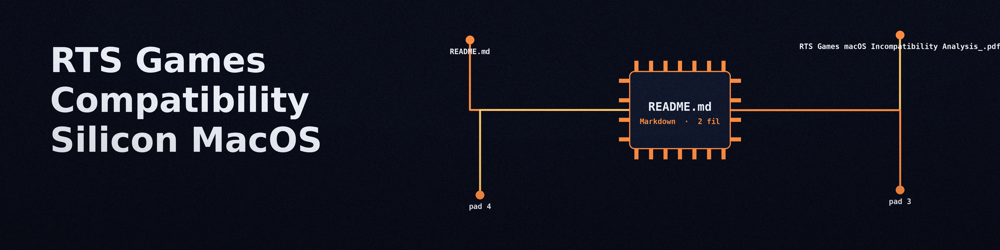

# RTS-Games-Compatibility-Silicon-MacOS

I keep this repo as my own record of which RTS games work on Apple
Silicon Macs and which ones do not. The short notes below are the
verdicts I care about most. The PDF in this repo holds the longer
analysis of the games that do not work: "RTS Games macOS
Incompatibility Analysis_.pdf", a 21 page document whose executive
summary covers the Spring engine titles, native support, CrossOver and
Game Porting Toolkit, Parallels and VMware, and cloud gaming.

The notes below are the author's own record. They were not re-tested on
a Mac in this pass, and their wording, including game spellings, is
preserved as written.

## Spring engine titles

Zero-K works with box64 userspace translator on Ubuntu arm64 parallels though without visual effects, Beyond All Reason does not work with box64, it requires cloud gaming. (Are these games worth playing if they are so hard to get installed, are there better alternatives?)

So really the only games that most people will struggle playing on macOS are those games that use spring.exe (Are those games worth playing, the engine seems highly outdated?)

## Native Mac ports that work great

```
Warzone 2100k works great (Native Mac Port)
OpenRA works great (Native Mac Port)
```

## Works on other platforms

I prefer playing Halo wars DE and Halo wars 2 on Xbox
and Age of Empires IV works on Xbox

(All these RTS games are on gamepass)

Red Alert 3 Works Great on Parallels. (Maybe even works on Crossover)

Tempest Rising works fantastic on macOS.

## Does not work on macOS

```
https://www.applegamingwiki.com/wiki/Company_of_Heroes_3 (Refuses to work on macOS through all forms of emulation, virtualization, translation)
```

## General notes

```
Hardware always trumps optimized Linux OS on x86_64 like catchyOS and Garuda Linux
```

```
Games with anticheat I just recommend playing on console if possible, RTS games usually don't have these restrictions, so I recommend mac for RTS + Xbox for Others
```

Reference used in the notes above:

```
https://www.applegamingwiki.com/wiki/Home
```
